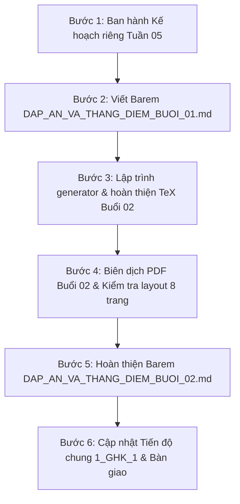

# CHIẾN DỊCH 1_GHK_1: KẾ HOẠCH NỘI DUNG & THI CÔNG CHI TIẾT TUẦN 05
## CHỦ ĐỀ: CÁC HÌNH PHẲNG TRONG THỰC TIỄN (TRỌNG TÂM HÌNH HỌC TRỰC QUAN & KẾT HỢP ĐẠI SỐ ĐỒNG BỘ)
### Đơn vị biên soạn: Lớp Toán Thầy Lĩnh (loptoanthaylinh.vn)
### Phạm vi áp dụng: 2 Phiếu kiểm tra định kỳ 45 phút (Buổi 01 & Buổi 02) - Hệ 4 mã đề hoán vị (101, 102, 103, 104)

---

## 🎯 I. TỔNG QUAN CHIẾN LƯỢC & VỊ TRÍ CỦA TUẦN 05

### 1. Vị trí bản lề trong Chiến dịch `1_GHK_1`
* **Giai đoạn chuyển giao vàng:** Sau 4 tuần đầu tiên tập trung cao độ vào **Số học thuần túy** (Tập hợp, Lũy thừa, Phép nhân chia và Thứ tự thực hiện các phép tính), **Tuần 05** là bước ngoặt đưa học sinh tiếp cận toàn diện với phân môn **Hình học trực quan** (Bài 18 và Bài 19 theo định hướng chương trình GDPT 2018).
* **Tỷ trọng trong đề thi chính thức GHK1:** Hình học trực quan chiếm từ **$2{,}5 - 3{,}0$ điểm** trong cấu trúc đề thi chính thức của các trường THCS (gồm $2 - 3$ câu trắc nghiệm nhận biết, $1$ ý tìm độ dài cạnh/chu vi và $1$ bài toán thực tế tính chu vi/chi phí làm rào/vật liệu).
* **Nguyên tắc "Không bỏ rơi Đại số":** Dù trọng tâm là Hình học, Tuần 05 vẫn tích hợp đồng bộ các bài toán **Thực hiện phép tính** (lũy thừa, ngoặc lồng) và **Tìm $x$** để duy trì phong độ tính toán liên tục cho học sinh, không để hổng kiến thức số học trước kỳ thi Giữa Kỳ.

---

## 📐 II. QUY CHUẨN THIẾT KẾ ĐỀ THI & ĐỊNH DẠNG TÀI LIỆU

### 1. Cấu trúc chuẩn 10 điểm / 45 phút
Mỗi buổi học gồm một phiếu kiểm tra chuẩn in **2 trang A4 (1 tờ 2 mặt)**, bao gồm:
* **Mặt trước (Trang 1/2):**
  * Tiêu đề đề thi, Thông tin học sinh, Khung điểm số & Lời phê Thầy/Cô.
  * Bảng điền nhanh đáp án trắc nghiệm (Câu 1 đến Câu 5).
  * **PHẦN I. TRẮC NGHIỆM KHÁCH QUAN (2,5 điểm):** 5 câu hỏi ($0{,}5$ đ/câu).
  * **PHẦN II. TỰ LUẬN - CÂU 1 (2,5 điểm):** Thực hiện phép tính (4 ý $a, b, c, d$ - mỗi ý $0{,}625$ đ).
* **Mặt sau (Trang 2/2):**
  * **CÂU 2 (2,5 điểm):** Tìm số tự nhiên $x$ (4 ý $a, b, c, d$ chia 2 cột - mỗi ý $0{,}625$ đ).
  * **CÂU 3 (2,5 điểm):** Bài toán thực tế Hình học (2 ý $a, b$ - mỗi ý $1{,}25$ đ).
  * Khung làm bài tự luận với **14 dòng kẻ chấm mờ chuẩn viết tay** (`\dongke{14}`).

### 2. Quy chuẩn 4 mã đề hoán vị tương đương
* Mỗi buổi gồm **4 mã đề: 101, 102, 103, 104** có độ khó, cấu trúc và thời lượng làm bài tương đương $100\%$.
* Toàn bộ 4 mã đề được đóng gói trong **1 file TeX duy nhất** $\to$ biên dịch ra **đúng 8 trang PDF hoàn hảo**, không bị nhảy trang, không bị lỗi tràn lề (*overfull hbox/vbox*).

---

## 🗺️ III. NỘI DUNG CHI TIẾT TỪNG BUỔI HỌC

---

### 📌 BUỔI 01: BÀI 18 - TAM GIÁC ĐỀU, HÌNH VUÔNG, LỤC GIÁC ĐỀU

#### 1. Mục tiêu kiến thức & Kỹ năng
* **Hình học:**
  * Nhận biết các yếu tố: đỉnh, cạnh, góc của tam giác đều (3 cạnh bằng nhau, 3 góc bằng $60^\circ$), hình vuông (4 cạnh bằng nhau, 4 góc vuông, 2 đường chéo bằng nhau và vuông góc), lục giác đều (6 cạnh bằng nhau, 6 góc bằng $120^\circ$, 3 đường chéo chính bằng nhau cắt nhau tại tâm).
  * Nhận biết hình ảnh thực tế: biển báo giao thông tam giác đều, viên gạch lát nền hình vuông, lỗ tổ ong hình lục giác đều.
  * Công thức tính chu vi: $C_{\text{tam giác đều}} = 3a$, $C_{\text{hình vuông}} = 4a$, $C_{\text{lục giác đều}} = 6a$.
* **Đại số phối hợp:**
  * Tính toán giá trị biểu thức chứa lũy thừa, tính nhanh phân phối $a \cdot b + a \cdot c$.
  * Biểu thức chứa ngoặc tròn $( )$, ngoặc vuông $[ ]$, ngoặc nhọn $\{ \}$.
  * Tìm $x$ từ biểu thức bậc nhất, phương trình lũy thừa $a \cdot b^x - c = d$, và tìm cạnh hình phẳng từ chu vi.

#### 2. Ma trận đề kiểm tra Buổi 01

| Phần | Câu | Dạng Toán | Cấp Độ | Đề 101 | Đề 102 | Đề 103 | Đề 104 |
| :---: | :---: | :--- | :---: | :--- | :--- | :--- | :--- |
| **I. Trắc nghiệm** *(2,5 điểm)* | Câu 1 | Tam giác đều | Nhận biết | Khẳng định sai về tam giác đều | Chu vi tam giác đều $a \to 3a$ | Số đo góc tam giác đều ($60^\circ$) | Tính cạnh $NP$ khi biết cạnh tam giác đều |
| | Câu 2 | Hình vuông | Nhận biết | Số đường chéo của hình vuông | Chu vi hình vuông cạnh $6\text{ cm}$ | Khẳng định sai về góc hình vuông | Tìm cạnh hình vuông khi chu vi là $28\text{ cm}$ |
| | Câu 3 | Lục giác đều | Nhận biết | Số đường chéo chính lục giác đều | Số đo mỗi góc lục giác đều ($120^\circ$) | Số cạnh, số góc lục giác đều | Cấu tạo: 6 tam giác đều ghép lại |
| | Câu 4 | Chu vi hình phẳng | Thông hiểu | Chu vi biển báo tam giác đều | Hình ảnh thực tế: lỗ tổ ong | Chu vi khung tranh hình vuông | Chu vi mảnh bìa lục giác đều |
| | Câu 5 | Tính chất nâng cao | Thông hiểu | Độ dài các đoạn từ tâm lục giác đều | Cạnh tam giác đều biết chu vi | Tính chất 2 đường chéo hình vuông | Đặc điểm: 6 đỉnh, 6 cạnh, 3 đ/c chính |
| **II. Tự luận** *(7,5 điểm)* | **Câu 1** *(2,5đ)* | **Thực hiện phép tính** | | | | | |
| | Ý a | Tính trực tiếp + lũy thừa | Nhận biết | $35 + 25 \cdot 2 - 3^3$ | $45 + 30 \cdot 2 - 2^4$ | $55 + 15 \cdot 3 - 3^3$ | $65 + 20 \cdot 3 - 2^5$ |
| | Ý b | Tính nhanh thừa số chung | Thông hiểu | $28 \cdot 64 + 28 \cdot 36 - 800$ | $36 \cdot 58 + 36 \cdot 42 - 600$ | $47 \cdot 73 + 47 \cdot 27 - 700$ | $54 \cdot 81 + 54 \cdot 19 - 400$ |
| | Ý c | Ngoặc vuông + lũy thừa | Thông hiểu | $140 : [50 - (42 - 2^2 \cdot 3)]$ | $160 : [50 - (46 - 2^4)]$ | $150 : [70 - (58 - 3^2 \cdot 2)]$ | $210 : [60 - (48 - 3^2 \cdot 2)]$ |
| | Ý d | Biểu thức lồng $\{ \ [ \ ( \ ) \ ] \ \}$ | Vận dụng | $300 : \{ 160 - [44 + (7 - 3)^2] \}$ | $400 : \{ 180 - [55 + (8 - 3)^2] \}$ | $500 : \{ 200 - [75 + (9 - 4)^2] \}$ | $600 : \{ 220 - [95 + (8 - 3)^2] \}$ |
| | **Câu 2** *(2,5đ)* | **Tìm số tự nhiên $x$** | | | | | |
| | Ý a | Bậc nhất có ngoặc | Nhận biết | $35 + 4(x - 3) = 63$ | $42 + 5(x - 2) = 77$ | $28 + 3(x - 5) = 55$ | $36 + 4(x - 6) = 68$ |
| | Ý b | Chuyển vế ngoặc vuông | Thông hiểu | $130 - [50 - (x - 4)] = 95$ | $140 - [60 - (x - 5)] = 105$ | $150 - [70 - (x - 6)] = 115$ | $160 - [80 - (x - 8)] = 125$ |
| | Ý c | Phương trình lũy thừa | Vận dụng | $3 \cdot 2^x - 7 = 41$ | $2 \cdot 3^x - 8 = 46$ | $5 \cdot 2^x - 15 = 65$ | $4 \cdot 3^x - 11 = 97$ |
| | Ý d | Tìm cạnh từ chu vi | Vận dụng | Chu vi hình vuông cạnh $x$ bằng $48\text{ cm}$ | Chu vi $\Delta$ đều cạnh $x$ bằng $45\text{ cm}$ | Chu vi lục giác đều cạnh $x$ bằng $54\text{ cm}$ | Chu vi hình vuông cạnh $x$ bằng $60\text{ cm}$ |
| | **Câu 3** *(2,5đ)* | **Toán thực tế** | | | | | |
| | Bối cảnh | Thực tế đời sống | Vận dụng | Vườn hoa hình vuông $12\text{ m}$, để lối đi $2\text{ m}$ | Vườn rau hình vuông $15\text{ m}$, để cổng vào $3\text{ m}$ | Bồn hoa lục giác đều ghép từ 6 $\Delta$ đều cạnh $3\text{ m}$ | Bãi cát lục giác đều cạnh $4\text{ m}$, để lối đi $2\text{ m}$ |
| | Ý a (1,25đ) | Tính chu vi | | Chu vi mảnh vườn hình vuông | Chu vi mảnh vườn hình vuông | Chu vi bồn hoa lục giác đều | Chu vi bãi cát lục giác đều |
| | Ý b (1,25đ) | Chiều dài rào & Chi phí | | Rào lưới thép ($65\,000\text{ đ/m}$) | Rào dây thép gai ($50\,000\text{ đ/m}$) | Viền gạch ngoài ($120\,000\text{ đ/m}$) | Thanh xốp bảo vệ ($85\,000\text{ đ/m}$) |

---

### 📌 BUỔI 02: BÀI 19 - CÁC HÌNH TỨ GIÁC ĐÃ HỌC (HÌNH CHỮ NHẬT, HÌNH THOI, HÌNH BÌNH HÀNH, HÌNH THANG CÂN)

> 📄 **Kế hoạch chi tiết toàn văn cho Buổi 02 đã được tách riêng tại:** [**KE_HOACH_BUOI_02.md**](file:///d:/4.%20GitHub/SACH/LOP6/PHIEU_KIEM_TRA/1_GHK_1/TUAN_5/buoi_2/KE_HOACH_BUOI_02.md) *(Bản in PDF: [**KE_HOACH_BUOI_02.pdf**](file:///d:/4.%20GitHub/SACH/LOP6/PHIEU_KIEM_TRA/1_GHK_1/TUAN_5/buoi_2/KE_HOACH_BUOI_02.pdf))*.

#### 1. Mục tiêu kiến thức & Kỹ năng
* **Hình học:**
  * **Hình chữ nhật:** 4 góc vuông, các cạnh đối song song và bằng nhau; hai đường chéo bằng nhau và cắt nhau tại trung điểm của mỗi đường.
  * **Hình thoi:** 4 cạnh bằng nhau, các cạnh đối song song; hai đường chéo vuông góc với nhau và cắt nhau tại trung điểm của mỗi đường.
  * **Hình bình hành:** Các cạnh đối song song và bằng nhau, các góc đối bằng nhau; hai đường chéo cắt nhau tại trung điểm của mỗi đường.
  * **Hình thang cân:** Hai đáy song song, hai cạnh bên bằng nhau, hai góc kề một đáy bằng nhau; hai đường chéo bằng nhau.
  * **Công thức chu vi:**
    * Hình chữ nhật: $C = 2(a + b)$.
    * Hình thoi: $C = 4a$.
    * Hình bình hành: $C = 2(a + b)$.
    * Hình thang cân: $C = a + b + 2c$ ($a, b$ là 2 đáy, $c$ là cạnh bên).
* **Đại số phối hợp:**
  * Kỹ năng tính toán biểu thức nhiều phép tính, lũy thừa và ngoặc nhọn.
  * Tìm số tự nhiên $x$: bài toán ngược tính kích thước tứ giác khi biết chu vi, tìm $x$ trong số mũ lũy thừa.
* **Toán thực tế:**
  * Bài toán lát nền gạch phòng học chữ nhật (chu vi viền chân tường, số lượng gạch, chi phí).
  * Làm khung sắt trang trí hình thoi, khung cửa bình hành, rào vườn hình thang cân.

#### 2. Ma trận đề kiểm tra Buổi 02 (Đã cập nhật theo yêu cầu chuẩn)

| Phần | Câu | Dạng Toán | Cấp Độ | Định Hướng Nội Dung 4 Mã Đề |
| :---: | :---: | :--- | :---: | :--- |
| **I. Trắc nghiệm** *(2,5 điểm)* | Câu 1 | Chia hết cho 2, 5 | Nhận biết | Dấu hiệu tận cùng chia hết cho 2, chia hết cho 5, chia hết cho cả 2 và 5. |
| | Câu 2 | Chia hết cho 3, 9 | Nhận biết | Dấu hiệu tổng các chữ số chia hết cho 3, chia hết cho 9; số chia hết cho 9 thì chia hết cho 3. |
| | Câu 3 | Điền chữ số $*$ thích hợp | Thông hiểu | Tìm chữ số $*$ để số $\overline{ab*}$ chia hết cho 3, cho 9 hoặc cho cả 2 và 5. |
| | Câu 4 | Tính chất chia hết | Thông hiểu | Tính chất chia hết của một tổng $a + b$ hoặc một hiệu $a - b$ cho một số tự nhiên. |
| | Câu 5 | Phối hợp nhiều dấu hiệu | Vận dụng | Số chia hết đồng thời cho 2, 3, 5, 9; số nhỏ nhất có 3 chữ số khác nhau chia hết cho cả 2 và 5. |
| **II. Tự luận** *(7,5 điểm)* | **Câu 1** *(2,5đ)* | **Thực hiện phép tính** | | |
| | Ý a | Tính trực tiếp + lũy thừa | Nhận biết | Số học kết hợp $2^3, 2^4, 2^5, 3^3$, phép nhân chia cộng trừ ưu tiên. |
| | Ý b | Đặt thừa số chung | Thông hiểu | Dạng $a \cdot b + a \cdot c - d$ với tổng nhóm bằng $100$. |
| | Ý c | Phối hợp ngoặc vuông | Thông hiểu | Biểu thức dạng $A : [B - (C - D^2)]$. |
| | Ý d | Biểu thức 3 tầng ngoặc | Vận dụng | Biểu thức lồng đủ $\{ \ [ \ ( \ ) \ ] \ \}$. |
| | **Câu 2** *(2,5đ)* | **Tìm số tự nhiên $x$** | | |
| | Ý a | Dạng $a + b(x - c) = d$ | Nhận biết | Phương trình bậc nhất giải xuôi từng bước chuyển vế. |
| | Ý b | Phương trình số mũ | Vận dụng | Dạng phương trình lũy thừa $a \cdot 2^x - b = c$ hoặc $a \cdot 3^x - b = c$. |
| | Ý c | **Tìm $x$ lớn nhất (ƯCLN)** | Vận dụng | $a \ \vdots \ x, b \ \vdots \ x$ và $x$ là số tự nhiên lớn nhất $\Rightarrow x = \text{ƯCLN}(a, b)$. |
| | Ý d | **Tìm $x \in \text{ƯC}$ có điều kiện** | Vận dụng | $a \ \vdots \ x, b \ \vdots \ x$ và $x > k \Rightarrow x \in \text{ƯC}(a, b) = \text{Ư}(\text{ƯCLN})$. |
| | **Câu 3** *(2,5đ)* | **Toán thực tế Tứ giác** | | |
| | Bối cảnh | Ứng dụng thực tế đời sống | Vận dụng | Làm hàng rào vườn chữ nhật / Viền dải đèn LED biển hiệu hình thoi / Nẹp gioăng cao su cửa sổ. |
| | Ý a (1,25đ) | Tính chu vi / đại lượng cơ sở | | Tính chu vi hình chữ nhật hoặc hình thoi. |
| | Ý b (1,25đ) | Tính toán vật tư & Chi phí | | Tính chiều dài vật tư sau khi trừ cổng và tổng số tiền thanh toán. |

---

## 📋 IV. BẢNG ĐÁNH GIÁ HIỆN TRẠNG & CHECKLIST HÀNH ĐỘNG TUẦN 05

### 1. Bảng đối soát các tệp tin theo thư mục con

| Vị Trí / Tên Tệp Tin | Trạng Thái | Mô Tả & Tồn Đọng Kỹ Thuật | Nhiệm Vụ Cần Xử Lý |
| :--- | :---: | :--- | :--- |
| **Thư mục con `buoi_1/`** | | | |
| [`Phieu_Kiem_Tra_Tuan_05_Buoi_01.tex`](file:///d:/4.%20GitHub/SACH/LOP6/PHIEU_KIEM_TRA/1_GHK_1/TUAN_5/buoi_1/Phieu_Kiem_Tra_Tuan_05_Buoi_01.tex) | ✅ Đã hoàn thiện | Nội dung chuẩn 4 mã đề (101, 102, 103, 104) | Duy trì ổn định |
| [`Phieu_Kiem_Tra_Tuan_05_Buoi_01.pdf`](file:///d:/4.%20GitHub/SACH/LOP6/PHIEU_KIEM_TRA/1_GHK_1/TUAN_5/buoi_1/Phieu_Kiem_Tra_Tuan_05_Buoi_01.pdf) | ✅ Đã biên dịch | Đúng chuẩn 8 trang A4 không lỗi | Đã đạt chuẩn |
| [`generate_tuan5_buoi1.py`](file:///d:/4.%20GitHub/SACH/LOP6/PHIEU_KIEM_TRA/1_GHK_1/TUAN_5/buoi_1/generate_tuan5_buoi1.py) | ✅ Đã hoàn thiện | Script sinh mã TeX tự động cho Buổi 1 | Đã đạt chuẩn |
| [`DAP_AN_VA_THANG_DIEM_BUOI_01.md`](file:///d:/4.%20GitHub/SACH/LOP6/PHIEU_KIEM_TRA/1_GHK_1/TUAN_5/buoi_1/DAP_AN_VA_THANG_DIEM_BUOI_01.md) | ❌ Chưa có | Chưa có file barem chấm chi tiết Buổi 1 | **Cần biên soạn ngay** theo form Tuần 4 |
| **Thư mục con `buoi_2/`** | | | |
| [`KE_HOACH_BUOI_02.md`](file:///d:/4.%20GitHub/SACH/LOP6/PHIEU_KIEM_TRA/1_GHK_1/TUAN_5/buoi_2/KE_HOACH_BUOI_02.md) | ✅ Đã hoàn thiện | Bản kế hoạch chi tiết markdown Buổi 2 | Đã cập nhật chuẩn |
| [`KE_HOACH_BUOI_02.pdf`](file:///d:/4.%20GitHub/SACH/LOP6/PHIEU_KIEM_TRA/1_GHK_1/TUAN_5/buoi_2/KE_HOACH_BUOI_02.pdf) | ✅ Đã biên dịch | Bản kế hoạch PDF 5 trang in đẹp mắt | Đã đạt chuẩn |
| [`Phieu_Kiem_Tra_Tuan_05_Buoi_02.tex`](file:///d:/4.%20GitHub/SACH/LOP6/PHIEU_KIEM_TRA/1_GHK_1/TUAN_5/buoi_2/Phieu_Kiem_Tra_Tuan_05_Buoi_02.tex) | ⚠️ Dở dang | Đang chứa văn bản mẫu "đang biên soạn..." | **Cần hoàn thiện toàn bộ nội dung** |
| [`generate_tuan5_buoi2.py`](file:///d:/4.%20GitHub/SACH/LOP6/PHIEU_KIEM_TRA/1_GHK_1/TUAN_5/buoi_2/generate_tuan5_buoi2.py) | ❌ Chưa có | Chưa có script sinh tự động Buổi 2 | **Cần lập trình script sinh TeX** |
| [`Phieu_Kiem_Tra_Tuan_05_Buoi_02.pdf`](file:///d:/4.%20GitHub/SACH/LOP6/PHIEU_KIEM_TRA/1_GHK_1/TUAN_5/buoi_2/Phieu_Kiem_Tra_Tuan_05_Buoi_02.pdf) | ❌ Chưa có | Chưa biên dịch file PDF chính thức | **Cần compile kiểm tra 8 trang chuẩn** |
| [`DAP_AN_VA_THANG_DIEM_BUOI_02.md`](file:///d:/4.%20GitHub/SACH/LOP6/PHIEU_KIEM_TRA/1_GHK_1/TUAN_5/buoi_2/DAP_AN_VA_THANG_DIEM_BUOI_02.md) | ⚠️ Dở dang | Toàn bộ các mục ghi "Đang cập nhật..." | **Cần cập nhật trọn vẹn lời giải & barem** |

---

### 2. Lộ trình thi công 5 bước dứt điểm Tuần 05

* **Pha 1 (Hoàn thiện Buổi 01):**
  * Soạn thảo chi tiết `DAP_AN_VA_THANG_DIEM_BUOI_01.md` khớp $100\%$ với các đề trong `Phieu_Kiem_Tra_Tuan_05_Buoi_01.tex`.
  * Có bảng trắc nghiệm 4 mã đề + Hướng dẫn chấm từng bước tự luận (mỗi bước $0{,}125 - 0{,}25$ điểm).
* **Pha 2 (Biên soạn & Tự động hóa Buổi 02):**
  * Xây dựng script `generate_tuan5_buoi2.py` với ngân hàng đề Toán 6 chọn lọc bám sát Bài 19 (Hình chữ nhật, hình thoi, hình bình hành, hình thang cân).
  * Chạy script tạo ra file `Phieu_Kiem_Tra_Tuan_05_Buoi_02.tex` hoàn chỉnh 4 mã đề $101, 102, 103, 104$.
* **Pha 3 (Biên dịch & Thẩm định Layout):**
  * Chạy biên dịch LaTeX (bằng engine có sẵn).
  * Đảm bảo PDF sinh ra chuẩn xác $8$ trang, không trang nào bị nhảy dòng sang trang thứ $9$.
* **Pha 4 (Barem Buổi 02):**
  * Điền đầy đủ đáp án trắc nghiệm cho cả 4 mã đề vào `DAP_AN_VA_THANG_DIEM_BUOI_02.md`.
  * Giải chi tiết từng ý của Câu 1, Câu 2 và Câu 3 (Toán thực tế) với lời giải mẫu mực, sư phạm.
* **Pha 5 (Đồng bộ hóa):**
  * Cập nhật trạng thái Tuần 05 trong `KE_HOACH_NOI_DUNG_GHK1.md` từ 🔄 "Đang khởi tạo" thành ✅ "Hoàn thành 100%".

---

## 💡 V. CÁC NGUYÊN TẮC SƯ PHẠM & BẪY SAI LẦM HỌC SINH CẦN LƯU Ý

1. **Tránh bẫy nhầm lẫn giữa Chu vi và Diện tích:**
   * Trong chương trình Toán 6, Tuần 05 học sinh **chỉ học các đặc điểm hình học và Chu vi**; công thức Diện tích hình bình hành, hình thoi, hình thang sẽ học tập trung ở **Tuần 06**.
   * Do đó, các bài toán thực tế ở Tuần 05 phải tập trung vào: **chu vi bồn hoa, chiều dài hàng rào, viền khung tranh, thanh nẹp bảo vệ mép sàn**, tuyệt đối không đưa công thức diện tích phức tạp vào làm học sinh bị quá tải.
2. **Bẫy trừ lối đi / cổng vào trong bài toán làm rào:**
   * Học sinh thường quên trừ độ dài lối đi (ví dụ: $C - 2\text{ m}$) trước khi nhân đơn giá. Đề thi các trường chuyên và trường điểm rất hay gài bẫy này ở ý b câu thực tế.
3. **Độ chính xác về thuộc tính hình học:**
   * *Hình chữ nhật:* Hai đường chéo bằng nhau nhưng **không nhất thiết vuông góc**.
   * *Hình thoi:* Hai đường chéo vuông góc nhưng **không nhất thiết bằng nhau**.
   * *Lục giác đều:* Có **3 đường chéo chính** và **6 đường chéo phụ** (tổng cộng 9 đường chéo). Đề thi luôn hỏi "đường chéo chính".
4. **Trình bày tự luận chuẩn mực:**
   * Các bài tìm $x$ và tính toán phải có các bước trung gian rõ ràng, không làm tắt.
   * Bài toán thực tế phải có đầy đủ lời giải, phép tính kèm đơn vị trong ngoặc đơn, và đáp số rõ ràng.
